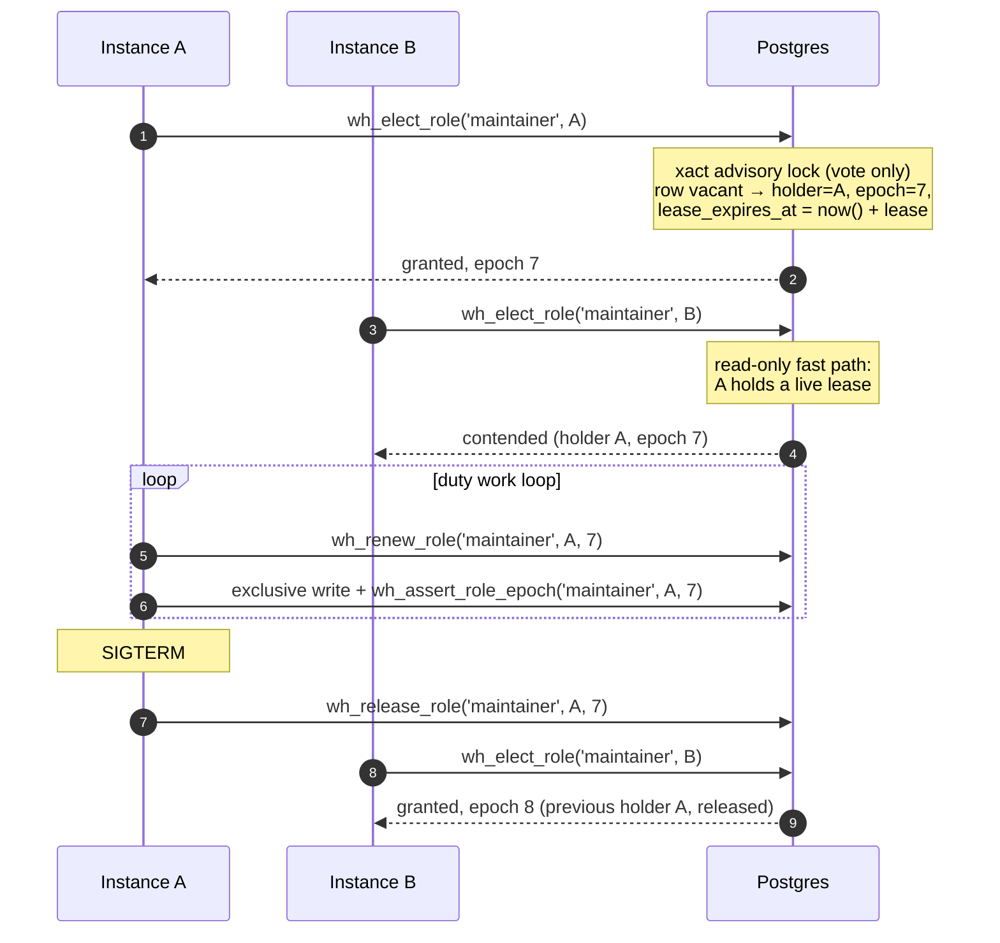

# Duty Role Assignment

**The advisory lock decides only the vote. The role is a row: a liveness-tied assignment with an epoch that exclusive work presents as a fencing token.**

:::new
**Implemented, and the only way to hold a duty** (library migrations `173_RoleAssignments.sql`, `184_RoleAssignmentResilience.sql`, `326_EveryDutyIsARoleAssignment.sql`, `330_CoordinationOnTheSignalBus.sql` and `355_RoleHoldersAreJudgedByTheLivenessRule.sql`, `PgRoleElector`, `DutyHolderWorker`). Tracks GitHub issue #966; the design questions are decided on #968 (section 11). Since #2044 every duty is a role assignment: `maintainer`, `migrator`, the commit-order stamper's leadership and any duty a host names. The session-lock elector, the legacy-lock bridge and the stamper's own lock are gone, and there is no switch back (section 6). Since #2140 a holder past its lease is judged by [the one liveness rule](/v1.0.0/fundamentals/workers/instance-liveness#liveness-rule) plus a progress window, and every grant watches its assignment and cancels `IDutyGrant.LostToken` on a loss (section 5). Section 10 lists the phases and what each one delivered; the released behavior is on [Capabilities and Duties](/v1.0.0/operations/startup/capabilities-and-duties#role-assignment-the-default).
:::

## 1. Why the session lock is not enough

Before role assignment, a duty (`migrator`, `maintainer`) was a **session advisory lock** held on a dedicated connection for the holder's entire tenure. The capability row written by `record_capability` only reported who held it: *the lock decided, the row reported*. That model was simple and had no timeout to tune, and it had three standing costs:

1. **One pinned direct connection per held duty.** A session lock does not survive a transaction-pooling front end, so every holder needs a connection that bypasses the pooler, and keeps it for as long as it holds the duty.
2. **No way to take a duty away from a holder that is alive but unhealthy.** The lock is released when the session ends. A holder whose event loop is blocked, or whose work connection is wedged, keeps its session and therefore keeps the duty. The same is true of a half-open TCP session after a hard kill, which holds the lock until the operating system's keepalive notices, by default two hours.
3. **A duty is consulted only when something asks for it.** A startup step with `RequiredCapability = maintainer` and `NonHolderBehavior.Skip` asks once, at that instance's startup. In a rolling deploy the old-version pod still holds the duty while every new pod starts, so each new pod is told "held elsewhere" and skips. When the old pod finally stops, nobody is asking any more, and the step never runs.

## 2. The model in one screen



Five pieces:

1. **The vote.** A single SQL function, `wh_elect_role`, run as one statement. It takes a *transaction-scoped* advisory lock keyed on the role, re-reads the assignment, voids it if it has lapsed, and assigns the caller if the role is free. The lock is released when the statement commits. Because the whole vote is one statement, a client that stalls cannot hold the vote lock: the server runs the statement to completion without a round trip to the client.
2. **The assignment.** `wh_role_assignments` has one row per role: holder instance id, epoch, `assigned_at`, `renewed_at`, `lease_expires_at`, the lease length, the election count, and the last vacancy (who, when, why). **That row is the authority from then on.** It is a virtual lock that needs no session and no pinned connection, and it survives a database restart.
3. **Liveness.** The assignment is valid while the holder is registered in `wh_service_instances`, is not tombstoned in `wh_instance_evictions`, **and** either its lease is unexpired or, past the lease, [the one liveness rule](/v1.0.0/fundamentals/workers/instance-liveness#liveness-rule) calls it live and it renewed inside the progress window it declared for its epoch (section 5). The lease is extended only by the holder's own work loop (`VerifyStillHeldAsync` renews it), never by a separate timer. Reaping, eviction and a lapse all void the assignment at the next vote.
4. **Fencing.** Every assignment carries an **epoch**, incremented on each new assignment and never reused. Exclusive work presents `(holder, epoch)` to `wh_assert_role_epoch` in the same transaction as its writes. A stale epoch raises SQLSTATE `WHF01` and the transaction's writes roll back. The check runs in SQL, where no paused process can argue with it.
5. **Release.** A graceful shutdown releases the role (`wh_release_role`) so the next vote hands it off at once rather than after the lease lapses.

### What the advisory lock still does, and what it no longer does

| Question | Session-lock model (released) | Role-assignment model (this proposal) |
|---|---|---|
| Who decides the holder | The session lock, for the whole tenure | The vote, under a transaction lock held for milliseconds |
| What proves the holder is still the holder | The session is still open | The row: registered, not tombstoned, and an unexpired lease or, past it, live by the one rule and renewing inside its progress window |
| Connection needed while holding | One pinned direct connection per duty | None. Every call is one statement on any pooled connection |
| A stuck-but-alive holder | Keeps the duty indefinitely | Stops renewing and loses the duty at its progress window (2 minutes by default), learning it within one renew interval |
| A hard-killed holder on a half-open socket | Keeps the lock until TCP keepalive (up to hours), bounded only by the reaper's definitive-dead cutoff | Replaced once the rule calls it dead, and never later than its progress window |
| Database restart or failover | Every session lock is lost; election restarts from nothing | Rows survive; the holder renews the same epoch |
| A paused holder that wakes up after losing the duty | Its session died, so its lock is gone; its writes are not fenced | Its writes present a stale epoch and are refused in SQL |

## 3. Schema

```sql
CREATE TABLE IF NOT EXISTS __SCHEMA__.wh_role_assignments (
  role                     TEXT PRIMARY KEY,
  holder_instance_id       UUID,                 -- NULL = vacant
  epoch                    BIGINT NOT NULL DEFAULT 0,
  assigned_at              TIMESTAMPTZ,
  renewed_at               TIMESTAMPTZ,
  lease_expires_at         TIMESTAMPTZ,
  lease                    INTERVAL,
  election_count           BIGINT NOT NULL DEFAULT 0,
  last_holder_instance_id  UUID,
  last_vacated_at          TIMESTAMPTZ,
  last_vacated_reason      TEXT                  -- released | lapsed | evicted | unregistered
);
```

There is deliberately **no foreign key** to `wh_service_instances`. A cascade would delete the row and lose the epoch, and the epoch must never go backwards. A reaped holder is detected by the vote, which voids the assignment and records why.

The row is never deleted. A release or a void sets the holder to NULL and keeps the epoch, so the next assignment is `epoch + 1` whatever happened in between.

### Functions

| Function | What it does | Locking |
|---|---|---|
| `wh_elect_role(role, instance, lease, cooldown, legacy_lock_key)` | The vote. Returns `outcome` (`granted`, `held`, `contended`, `cooling_down`, `legacy_holder`, `refused`), the holder, the epoch, the lease remaining, and the previous holder and void reason when this vote replaced one | Read-only fast path when a live holder exists; otherwise `pg_advisory_xact_lock` on the role plus `FOR UPDATE` on the row |
| `wh_renew_role(role, instance, epoch)` | Extends the lease by the stored lease length, from `now()`. Refuses a lapsed lease, a wrong epoch, and a tombstoned holder | One `UPDATE … WHERE` |
| `wh_release_role(role, instance, epoch)` | Vacates the role with reason `released`, only when `(instance, epoch)` is current | One `UPDATE … WHERE` |
| `wh_assert_role_epoch(role, instance, epoch)` | The fence. Raises `WHF01` unless `(instance, epoch)` is the current, unexpired, non-tombstoned assignment. Takes `FOR SHARE` on the row, so a re-vote cannot commit between the check and the caller's commit | `FOR SHARE` on the row |
| `wh_role_assignment_status()` | One row per role with holder, epoch, timestamps, lease remaining, election count, last vacancy, and a computed `state` of `held`, `lapsed` or `vacant` | None |

The vote also writes and removes the `wh_instance_capabilities` row through `record_capability` and `release_capability`, so every surface that reads holdings today keeps working. In this model the capability row still *reports*; the difference is that the assignment row, not a session, is what it reports on.

### Added in migration 184

Migration 184 is the last word on every role function, and is a bootstrap region, because the migrator is elected before migrations run.

| Function | What it does |
|---|---|
| `wh_vote_role(role, instance, lease, cooldown, legacy_lock_key, version_key, bridge_pid)` | The vote, with the per-duty lease, the caller's version (for the drain and the newest-version preference) and its bridge session. Adds the outcomes `draining` and `deferred` |
| `wh_vote_roles(roles[], leases[], instance, cooldown, legacy_lock_keys[], version_key)` | Several votes in one statement, in role order |
| `wh_renew_role_lease(role, instance, epoch, legacy_lock_key)` | Renewal answering `renewed`, `drain` or `lost`; an unbridged holder passes the legacy key and steps aside for a session-lock holder it sees |
| `wh_mark_role_duty_backend(role, instance, epoch, mark)` | Marks, or clears, the calling backend as the one running the duty's statement (the backstop) |
| `wh_end_lapsed_bridge(role, legacy_lock_key)` | Ends a lapsed bridged holder's legacy-lock session, and only that one |
| `wh_request_role_drain(role, instance, lease, version_key)` | A bridged caller that could not take the legacy lock records its candidacy and asks an older live holder to drain; assigns nothing |
| `wh_elect_role`, `wh_renew_role` | The phase 1 entry points, kept as wrappers for an instance on the release before |

Migration 326 redefines `wh_vote_role`, `wh_renew_role_lease`, `wh_vote_roles` and `wh_end_lapsed_bridge` with the same signatures (section 6): the legacy keys and bridge session they take are no longer read, and the bridge expiry ends nothing and answers `NULL`. It adds `_role_held_outside_assignment` and drops `_advisory_lock_held_elsewhere`, so no role function reads an advisory lock.

The row gained the holder's version key, the drain request, the marked duty backend, the bridge session and whether the last involuntary vacancy was fleet-wide; `wh_role_candidates` records who is voting for each role, on which version.

### Added in migration 355 (#2140)

Also a bootstrap region, for the same reason. Section 5 explains each choice.

| Object | What it does |
|---|---|
| `wh_role_assignments.progress_window`, `progress_epoch` | The window the holder declared, and the epoch that declared it. NULL: none declared, and the lease alone decides |
| `_role_holder_kept_live(row, at)` | The one place the role asks the rule: true when the holder declared a window for this epoch, renewed inside it, and `wh_instance_is_live` calls it live |
| `_role_lapse_reason(row)` | Redefined: past the lease, and with no marked duty backend running a statement, lapsed only when `_role_holder_kept_live` is false. The vote, the renewal, the status and the duty-backend mark all decide through it |
| `wh_assert_role_epoch(role, instance, epoch)` | Redefined: the fence accepts an unexpired lease, a running marked duty backend, or a holder `_role_holder_kept_live` keeps, the same three the vote accepts |
| `wh_declare_role_progress_window(role, instance, epoch, window)` | The holder declares its window once it holds an epoch; zero or NULL declares none. False when `(instance, epoch)` is not the current valid assignment |
| `wh_role_is_held(role, instance, epoch)` | Whether `(instance, epoch)` is the current valid assignment, judged as the vote judges it. The grant watch's read; it writes nothing |

{verified: RoleHolderLivenessSqlTests.DeclareProgressWindow_IsRefusedToAHolderThatDoesNotHoldTheRole_AndAZeroWindowTurnsItOffAsync, RoleHolderLivenessSqlTests.RoleHeld_AnswersForTheCurrentHolderAndEpochOnlyAsync, RoleHolderLivenessSqlTests.RoleHeld_ReadsTheAssignmentByItsPrimaryKeyAsync, CoordinationSourceGuardTests.ARoleHolder_IsJudgedPastItsLeaseByTheOneLivenessRuleAsync}

### The vote lock key

`pg_advisory_xact_lock((table_oid << 32) | hashtext(role))`, where `table_oid` is the oid of this schema's `wh_role_assignments`. Keying on the table's oid makes the lock schema-scoped by construction (issue #962) with no schema name handled as text, which also absorbs the two migration runners' different `__SCHEMA__` substitutions. A collision with another advisory-lock family can only make a vote wait a few milliseconds longer. It can never change the outcome, because the row, not the lock, is the authority.

## 4. Time: every bound is computed by the database

Every timestamp in the row is written with `now()` inside the statement, and every comparison is made against `now()` in the next statement. No instance clock ever reaches the table. The function returns the **remaining** lease as an interval, a duration rather than an instant, so a caller measuring against it uses its own monotonic clock and is unaffected by skew between its wall clock and the database's.

The one place two clocks meet is a database failover, when the new primary's `now()` is compared with timestamps the old primary wrote. NTP-synchronized servers keep that skew to milliseconds, against leases measured in seconds.

## 5. Liveness, lapse and hysteresis {#liveness}

**Inside its lease a holder holds. Past its lease it is judged by the one liveness rule, plus a progress check of the role's own (#2140, migration 355).** A holder past its lease keeps the role only while all three hold:

1. it declared a **progress window** for its current epoch;
2. it **renewed inside that window** (its last renewal, which only its own work loop sends, is newer than the window);
3. **[the one liveness rule](/v1.0.0/fundamentals/workers/instance-liveness#liveness-rule) calls its instance live** (`wh_instance_is_live`: a recent heartbeat, or a held alive-lock on its notification connection), the same rule the claim, the reap, the standby handshake and every other reader asks.

All three are one helper, `_role_holder_kept_live`. `_role_lapse_reason`, which the vote, the renewal, the status and the duty-backend mark decide through, calls it, and so does the fence, `wh_assert_role_epoch`, so the fence treats a holder as live exactly when the vote does. The duty-backend backstop (section 11, decision 1) still holds the role open while the holder's marked statement runs. What remains role-specific is the epoch fence and the progress check; "is this instance alive" has one answer.
{verified: RoleHolderLivenessSqlTests.Vote_AHolderPastItsLease_ThatTheRuleCallsLive_AndThatMadeProgressInsideItsWindow_KeepsTheRoleAsync, RoleHolderLivenessSqlTests.Vote_ADirectHolderHoldingItsAliveLock_DoesNotLapse_WhileItsHeartbeatIsPastOneBeatAsync, RoleHolderLivenessSqlTests.Status_ReportsAHolderKeptByTheRule_AsHeldAsync, CoordinationSourceGuardTests.ARoleHolder_IsJudgedPastItsLeaseByTheOneLivenessRuleAsync}

```sql{
title: "Whether a holder keeps its role past its lease"
description: "_role_holder_kept_live from migration 355: the holder declared a progress window for this epoch, renewed inside it, and the one liveness rule calls it live. The progress check comes first, so the rule is asked only for a holder inside its window."
category: "Design"
difficulty: "ADVANCED"
tags: ["role-assignment", "liveness", "progress-window", "fencing", "migration-355"]
tests: ["RoleHolderLivenessSqlTests.Vote_AHolderPastItsLease_ThatTheRuleCallsLive_AndThatMadeProgressInsideItsWindow_KeepsTheRoleAsync", "RoleHolderLivenessSqlTests.Vote_AHolderTheRuleCallsDead_LapsesAtItsLease_InsideItsWindowAsync", "RoleHolderLivenessSqlTests.Vote_AConnectedButStuckHolder_LapsesAtItsProgressWindow_ThoughTheRuleCallsItLiveAsync", "RoleHolderLivenessSqlTests.ProgressWindow_CountsOnlyForTheEpochThatDeclaredItAsync"]
}
-- migration 355
SELECT p_row.progress_window IS NOT NULL
   AND p_row.progress_epoch = p_row.epoch
   AND p_row.renewed_at + p_row.progress_window > p_at
   AND wh_instance_is_live(p_row.holder_instance_id)
```

**Why the lease stopped being a liveness rule of its own.** Before #2140 a holder lapsed one lease (15 seconds) after its last renewal, and it renewed only when its work loop verified before a unit of exclusive work. A freshly elected holder busy with its startup, or inside one long unit of work, lapsed although every other reader of liveness called it live. A restart could move the `maintainer` role back and forth, and the old holder learned of the loss only on its next verify, minutes later, with two instances each believing it held the role. #2027 had already given every other reader one rule; the lease was the one left.

**Why a progress check remains.** The rule answers whether the instance is there, not whether its duty loop is moving. The heartbeat comes from `HeartbeatWorker`, independent of the duty loop, so a holder whose loop is wedged keeps beating, and a direct one keeps its alive-lock. Judged by the rule alone it would keep the role for as long as its process lives. Progress is counted only from renewals, which only the work loop sends, so a holder that is connected but stuck loses the role at the end of its window.

**The lease is renewed by the work loop, not by a timer.** `IDutyGrant.VerifyStillHeldAsync` was already the call "a long-tenure holder makes before each unit of exclusive work". In this model it renews the lease, and that renewal is the progress the window counts. A separate renewal timer would keep a stuck holder alive, which is the failure this is meant to remove; for the same reason the grant watch below only reads.

Renewals are throttled locally: within one `RenewInterval` of the last successful renewal, measured on the monotonic clock from the moment that request was *sent*, `VerifyStillHeldAsync` answers from memory. That is safe because the database computed the lease from a later instant than the send, and `RenewInterval` is a fraction of the lease. The throttle only saves round trips. It never lets a write through, because writes are fenced in SQL.

A renewal that fails for a transient reason (the database unreachable for a moment) answers false without giving up the grant, because the lease may still be valid and the next verify asks again. An explicit refusal (a lapsed lease, a wrong epoch, a tombstone) loses the grant for good, and a lost grant never asks the database again.

### The progress window {#progress-window}

`RoleAssignmentOptions.ProgressWindow` (configuration key `Whizbang:Database:RoleAssignment:ProgressWindow`, default 2 minutes) is how long a holder the rule calls live may go without renewing before it loses the role. Zero turns it off, and the lease alone decides, as before.

- **Declared per epoch.** Right after a grant, the holder declares its window (`wh_declare_role_progress_window`), on both the single vote and the multi-role vote. The window counts only for the epoch that declared it, so a window left on the row by an earlier holder never keeps a later one.
- **Never shorter than the role's lease** (`ProgressWindowFor`): a window shorter than the lease would never apply, since inside the lease the holder holds anyway.
- **A declaration that fails is logged, not thrown.** Without a window the holder is judged by its lease alone, exactly as before, which can only shorten its tenure.
- **An older release declares none**, so its holders are judged by their lease, exactly as before. One epoch is never judged by two rules in a mixed-version fleet.

{verified: RoleAssignmentOptionsTests.ProgressWindow_DefaultsToTwoMinutesAsync, RoleAssignmentOptionsTests.ProgressWindowFor_IsNeverShorterThanTheRolesLease_AndZeroTurnsItOffAsync, RoleAssignmentOptionsTests.Validate_RefusesANegativeProgressWindowAsync, RoleHolderLivenessSqlTests.DeclareProgressWindow_IsRefusedToAHolderThatDoesNotHoldTheRole_AndAZeroWindowTurnsItOffAsync, RoleHolderLivenessSqlTests.ProgressWindow_CountsOnlyForTheEpochThatDeclaredItAsync, RoleHolderLivenessSqlTests.Vote_AHolderThatDeclaredNoWindow_LapsesAtItsLease_AsBeforeAsync, RoleHolderLivenessE2ETests.TheVoteManyPath_DeclaresTheWindowForEveryRoleItWinsAsync, RoleHolderLivenessE2ETests.WithTheProgressWindowOff_AHolderLapsesAtItsLease_AsBeforeAsync, RoleHolderLivenessE2ETests.AWatchCheck_ConfirmsTheRole_AndADeclarationThatFails_LeavesTheGrantHeldAsync}

### When a holder loses the role {#when-a-holder-loses-the-role}

With the defaults (renew interval 5 s, lease 15 s, progress window 2 minutes, one beat 30 s):

| Holder | Loses the role | Verified |
|---|---|---|
| Renewing on time | Never | {verified: RoleHolderLivenessSqlTests.Vote_AHolderPastItsLease_ThatTheRuleCallsLive_AndThatMadeProgressInsideItsWindow_KeepsTheRoleAsync} |
| Busy with a slow startup or one long unit of work, live by the rule | Not while it renews inside its window; its late verify renews it and it carries on | {verified: RoleHolderLivenessE2ETests.ARestartWithASlowStartup_KeepsOneHolder_AndTheHoldersLateVerifyRenewsItAsync} |
| Connected but stuck: heartbeating, its work loop not verifying | At the end of its progress window after its last renewal, although the rule calls it live; it learns of the loss within one renew interval | {verified: RoleHolderLivenessSqlTests.Vote_AConnectedButStuckHolder_LapsesAtItsProgressWindow_ThoughTheRuleCallsItLiveAsync, RoleHolderLivenessE2ETests.AConnectedButStuckHolder_LosesTheRoleAtItsProgressWindow_AndLearnsItWithinOneRenewIntervalAsync} |
| Crashed, direct | Once the rule calls it dead and not before its lease: its alive-lock goes with the process, so about one beat (30 s) | {verified: RoleHolderLivenessSqlTests.Vote_AHolderTheRuleCallsDead_LapsesAtItsLease_InsideItsWindowAsync} |
| Crashed behind a transaction pooler | Once the rule calls it dead or its window ends, whichever is first; with the defaults its heartbeat window (150 s) outlasts the progress window, so about 2 minutes | {verified: RoleHolderLivenessSqlTests.Vote_AHolderTheRuleCallsDead_LapsesAtItsLease_InsideItsWindowAsync, RoleHolderLivenessSqlTests.Vote_AConnectedButStuckHolder_LapsesAtItsProgressWindow_ThoughTheRuleCallsItLiveAsync} |
| Hard-killed on a half-open connection that still holds its alive-lock | At the end of its progress window, not at TCP keepalive | {verified: RoleHolderLivenessSqlTests.Vote_AConnectedButStuckHolder_LapsesAtItsProgressWindow_ThoughTheRuleCallsItLiveAsync} |
| Evicted or unregistered | At the next vote, whatever its lease or window | {verified: RoleAssignmentSqlTests.Elect_WhenTheHolderIsTombstoned_VoidsItAsEvictedAsync} |
| On an older release, or with the window off | At its lease (15 s), as before | {verified: RoleHolderLivenessSqlTests.Vote_AHolderThatDeclaredNoWindow_LapsesAtItsLease_AsBeforeAsync, RoleHolderLivenessE2ETests.WithTheProgressWindowOff_AHolderLapsesAtItsLease_AsBeforeAsync} |
| Released gracefully | At once, with no cool-down | {verified: RoleAssignmentElectorE2ETests.GracefulRelease_HandsOffAtOnce_WithNoLapseWaitAsync} |

So a dead holder is never replaced before its lease and never after its progress window; between the two, the rule decides.

### Learning of a loss: the grant watch and `LostToken` {#grant-watch}

Each role-assignment grant watches its own assignment. Once per `RenewInterval` it reads `wh_role_is_held(role, instance, epoch)`, which judges the assignment exactly as the vote does and writes nothing, so a watch tick never counts as progress. On a loss it cancels `IDutyGrant.LostToken`; a release or a disposal cancels it too.

- **A watch that cannot reach the database** retries on the next tick. Once a whole lease has passed with no confirmation (a renewal or a watch check), it fences itself and cancels the token anyway, because by then another instance may be entitled to the role.
- **Checks never pile up.** A tick that finds the previous check still running skips, and a tick behind a release finds the tenure ended and asks nothing.
- **A schema without the watch** (before 355) answers that the function is missing; the watch stops, and the holder learns of a loss on its next verify, as before.
- **Other grants** offer `LostToken` as a default member that is never canceled, so an `IDutyGrant` that cannot observe a loss on its own keeps working unchanged.

The [holder loop](/v1.0.0/operations/startup/capabilities-and-duties#the-holder-loop) runs a role's acquisition and owed work under a token linked to `LostToken`. A loss observed mid-work cancels that work, the loop lets the role go, logs it once, and votes again on its next pass; `DutyHolderWorker.Holds(role)` answers false from the moment of the loss, without waiting for a pass. A host that is stopping is not mistaken for a loss: the role is kept for the host's own release.
{verified: RoleHolderLivenessE2ETests.TheOldHolder_ObservesItsLossWithinOneRenewInterval_SoExclusiveWorkNeverOverlapsAsync, RoleHolderLivenessE2ETests.AGrantWhoseWatchCannotConfirmTheRoleForALease_FencesItselfAsync, RoleHolderLivenessE2ETests.AReleasedGrant_EndsItsWatch_AndCancelsItsTokenAsync, RoleHolderLivenessE2ETests.ATickWhileTheLastCheckIsStillRunning_Skips_SoChecksNeverPileUpAsync, RoleHolderLivenessE2ETests.AWatchTickBehindARelease_FindsTheTenureEnded_AndAsksNothingAsync, RoleHolderLivenessE2ETests.OnASchemaWithoutTheWatch_TheGrantKeepsItsRole_AndStopsWatchingAsync, RoleHolderLivenessSqlTests.RoleHeld_AnswersForTheCurrentHolderAndEpochOnlyAsync, DutyGrantContractTests.LostToken_OfAGrantThatCannotObserveALoss_IsNeverCanceledAsync, DutyHolderWorkerTests.AGrantLostMidAcquisitionWork_CancelsThatWork_AndTheWorkerLetsTheRoleGoAsync, DutyHolderWorkerTests.AGrantLostMidOwedWork_CancelsThatWork_AndRunsNoMoreAsync, DutyHolderWorkerTests.Holds_TurnsFalseTheMomentTheGrantIsLost_WithoutWaitingForAPassAsync, DutyHolderWorkerTests.StoppingDuringWork_IsNotMistakenForALostGrant_AndKeepsTheRoleForTheHostsStopAsync}

### Design choices and trade-offs {#liveness-design-choices}

| Choice | Reason, and what it costs | Verified |
|---|---|---|
| Past its lease, a holder is judged by `wh_instance_is_live`, through one helper the vote and the fence both call. | One definition of alive for every reader (#2027); a role that kept its own rule lapsed live holders and bounced the role on a restart. One helper means the fence can never accept a holder the vote voided, or the reverse. **Cost:** a crashed holder is replaced when the rule calls it dead, about one beat (30 s) for a direct instance, not at 15 s. Duties tolerate tens of seconds, and its writes are fenced by the epoch either way. | {verified: CoordinationSourceGuardTests.ARoleHolder_IsJudgedPastItsLeaseByTheOneLivenessRuleAsync, RoleHolderLivenessSqlTests.Vote_AHolderTheRuleCallsDead_LapsesAtItsLease_InsideItsWindowAsync} |
| The role keeps a progress window, counted from renewals only. | The rule cannot see a wedged duty loop behind a healthy heartbeat. **Cost:** a connected but stuck holder keeps the role up to its window (2 minutes by default) instead of 15 s; lower `ProgressWindow` for a duty whose stalls cost more than its hand-offs. A crashed pooled holder, whose heartbeat window outlasts the progress window, is also replaced at about the window. | {verified: RoleHolderLivenessSqlTests.Vote_AConnectedButStuckHolder_LapsesAtItsProgressWindow_ThoughTheRuleCallsItLiveAsync, RoleHolderLivenessE2ETests.AConnectedButStuckHolder_LosesTheRoleAtItsProgressWindow_AndLearnsItWithinOneRenewIntervalAsync} |
| The window is declared per epoch, and none declared means the lease alone. | A window must never outlive the holder that chose it, and an older release, which declares nothing, must be judged exactly as it judges itself. | {verified: RoleHolderLivenessSqlTests.ProgressWindow_CountsOnlyForTheEpochThatDeclaredItAsync, RoleHolderLivenessSqlTests.Vote_AHolderThatDeclaredNoWindow_LapsesAtItsLease_AsBeforeAsync} |
| A lease comparison outside the role's two deciding functions fails a source guard. | Gravity: the next author cannot quietly reintroduce the lease as a liveness verdict. The allowlist names `_role_lapse_reason`, `wh_assert_role_epoch`, the fleet-wide-lapse classifier, 173's unused helper and the partition-assignment lease. | {verified: CoordinationSourceGuardTests.SqlLeaseVerdicts_AppearOnlyInTheAllowlistedFunctionsAsync} |
| The grant watch reads once per renew interval and never renews. | A holder learns of a loss within one interval instead of on its next verify. A watch that renewed would be the renewal timer that keeps a stuck holder alive. **Cost:** one primary-key read per held role per interval. | {verified: RoleHolderLivenessE2ETests.TheOldHolder_ObservesItsLossWithinOneRenewInterval_SoExclusiveWorkNeverOverlapsAsync, RoleHolderLivenessSqlTests.RoleHeld_ReadsTheAssignmentByItsPrimaryKeyAsync} |
| A watch that cannot confirm the role for a whole lease fences itself. | After a lease without a confirmation another instance may hold the role; stopping is the safe answer when the database cannot say. | {verified: RoleHolderLivenessE2ETests.AGrantWhoseWatchCannotConfirmTheRoleForALease_FencesItselfAsync} |
| Exclusive work is canceled through `LostToken`, and database writes stay fenced by the epoch. | **Cost:** exclusive work may run on two instances for at most one renew interval plus the time the work takes to observe its cancellation. A database write in that window still presents a stale epoch and is refused, so only work outside the database can overlap. | {verified: RoleHolderLivenessE2ETests.TheOldHolder_ObservesItsLossWithinOneRenewInterval_SoExclusiveWorkNeverOverlapsAsync, RoleAssignmentSqlTests.AssertEpoch_WithAStaleEpoch_RaisesInSql_AndTheWriteBesideItRollsBackAsync} |

**What it costs the database.** Measured with 500 registered instances (`RoleHolderLivenessCostScenarioTests`, 355's definitions against 184's): the vote's fast path went from 0.31 ms to 0.47 ms while the holder is inside its lease, and costs 1.32 ms when it finds the holder past its lease and kept live, where the rule reads the holder's instance row and the alive-locks. The buffers each statement touches inside the lease are unchanged, and nothing scales with the fleet beyond that one lookup. Buffers carry the gate; timings are recorded, never gated.
{verified: RoleHolderLivenessCostScenarioTests.RoleStatements_JudgedByTheRule_VersusTheLeaseAlone_ReportAsync}

### Hysteresis

It has two parts:

- **The lapse threshold is several missed beats.** `lease = RenewInterval × MissedRenewalsBeforeLapse` (defaults 5 s × 3 = 15 s). One slow renewal does not cost the role, and past the lease a live holder has its progress window.
- **A cool-down after an involuntary lapse.** An instance whose assignment was voided as `lapsed` cannot be re-elected for `CooldownAfterLapse` (default 15 s), so a slow instance cannot win the role back the moment it recovers and bounce it again. A graceful release carries no cool-down, because it was not a health signal.

**The failover bound** after a crash is therefore the moment the rule calls the holder dead, no earlier than its lease and no later than its progress window, plus the successor's next attempt, all measured in database time.

## 6. Mixed-version fleets: never both act

During a rolling deploy, an instance on an older release may hold a duty by its own session lock while new instances use rows. The two must never both act, and old code cannot be changed. An older release's elector already records its win through `record_capability`, so the new release reads that record, never the lock (#2044):

| Direction | Mechanism | Verified |
|---|---|---|
| **New defers to old** | While an instance that recorded a holding of the role, and is not the role's assignment holder, is live by [the one liveness rule](/v1.0.0/fundamentals/workers/instance-liveness#liveness-rule), the vote answers `legacy_holder` and writes no assignment. A holding recorded by an instance the rule calls dead does not count | {verified: RoleAssignmentResilienceSqlTests.Vote_WhileALiveInstanceHoldsTheDutyOutsideTheTable_AnswersLegacyHolderAsync, RoleAssignmentResilienceSqlTests.Vote_DoesNotCountAHolderOutsideTheTable_ThatTheLivenessRuleCallsDeadAsync, RoleAssignmentElectorE2ETests.MixedFleet_AnOlderReleasesRecordedHolding_IsSeenByTheVote_AndNoAssignmentIsWrittenAsync} |
| **Old defers to new** | An older instance cannot see the row, so the new holder yields: its renewal finds the recorded holding, and the role is vacated with `last_vacated_reason = legacy_holder` within one renew interval | {verified: RoleAssignmentResilienceSqlTests.RenewLease_StepsAside_WhenALegacyHolderTookTheLockAfterTheVoteAsync, RoleAssignmentResilienceE2ETests.AHolder_StepsAsideWithinOneRenewal_WhenAnOlderReleaseTookTheDutyOutsideTheTableAsync, RoleAssignmentChaosTests.RollingDeploy_FromTheSessionLockRelease_NeverHasBothActingAsync} |

**The bridge, removed.** Phases 1 to 4 bridged the two mechanisms with locks: a new holder also held the duty's legacy session lock (`HoldLegacySessionLock`), the vote and the renewal read `pg_locks` for the legacy key, and a lapsed bridged holder's lock session was ended (decision 4). The bridge cost the pinned connection role assignment exists to remove, and reading a lock gave a second answer to who holds a duty. Migration 326 removed all of it. The functions an older release calls keep their signatures and ignore the legacy key and bridge session they are passed, so an older bridged instance is answered from the table alone, and its drain request still reaches an older holder.
{verified: RoleAssignmentResilienceSqlTests.Vote_IgnoresAnAdvisoryLockOnTheLegacyKey_AndRecordsNoBridgeSessionAsync, RoleAssignmentResilienceSqlTests.EndLapsedBridge_EndsOnlyTheLapsedHoldersLockSession_AndOnlyOnceAsync, RoleAssignmentResilienceSqlTests.TheAdvisoryLockReader_IsGoneAsync, RoleAssignmentResilienceE2ETests.ABridgedNewerInstance_StillAsksTheOlderHolderToDrainAsync}

**The gap that remains.** For up to one renew interval, an older instance that takes the duty after the vote acts beside the new holder until the holder's renewal sees the record. And an older instance configured with role assignment off, whose stamper takes its own leader lock, records nothing, so the vote cannot see it at all. The cluster-wide stand-down (#2022, slice 2) closes both.

### Migration path from `PgDutyElector`

1. **Phases 1 and 2.** Migration 173 is additive. `PgRoleElector` shipped beside `PgDutyElector`, opt-in through `AddWhizbangRoleAssignment()`, with the acquisition hook (section 7).
2. **Phases 3 and 4, shipped together.** Role assignment is the Postgres driver's default registration, bridged, and the migrator is held by assignment. The session-lock elector remained as the delegate for any duty that was not a role, and as the whole elector when `Enabled = false`.
3. **Phase 5 (#2044, migration 326).** Every duty is a role assignment. `PgDutyElector`, `DutyLockKey`, `CommitOrderStamperLockKey` and `DutyContentionBackoff` are deleted; the bridge is gone; the keys `Whizbang:Database:RoleAssignment:Enabled`, `Whizbang:Database:RoleAssignment:HoldLegacySessionLock` and `Whizbang:Database:Stamper:AdvisoryLockKey` are [removed keys](/v1.0.0/operations/configuration/configuration-reference#removed-keys).
{verified: RoleAssignmentElectorE2ETests.EveryDuty_IsHeldByAssignment_EvenOneTheHolderLoopDoesNotHoldAsync, CoordinationSourceGuardTests.NoDuty_IsHeldByAnAdvisoryLockAnywhereAsync, UnknownConfigurationKeyCheckTests.Removed_WhizbangCoreDeclaresEveryFormerTableEntry_ThroughTheAttributeAsync}

**Upgrading.** A rolling deploy from a release that held duties by session lock needs nothing: its instances record their holdings, and the vote defers to them while they are live. A deploy from a release that already had role assignment on needs nothing either: the phase 1 entry points (`wh_elect_role`, `wh_renew_role`) keep working for the old instances, which count as the oldest version, so the role moves to the new release (section 11, decisions 2 and 3).

**A host's own duty is replaced more slowly after a crash.** Under the session-lock elector a duty that was not a role was handed over the moment its holder's session ended. As a role it is replaced once the liveness rule calls its holder dead, no earlier than its lease (section 5), about 30 seconds for a direct instance. A clean release still hands it over at once.
{verified: DutyElectionE2ETests.DirtyDeath_JudgedByTheLivenessRule_HandsTheDutyOver_AndTheGrantKnowsItIsLostAsync, RoleAssignmentElectorE2ETests.GracefulRelease_HandsOffAtOnce_WithNoLapseWaitAsync}

**The migrator** moved in phase 4. Its vote is part of the schema bootstrap closure (migration 184 is a bootstrap region, and so is the vote's redefinition in 326), so the assignment table and functions exist before the first migration. Migrator waiters watch the assignment row (`MigratorWatch`) and any holding recorded outside the table by a live migrator on an older release; since 326 they read no lock. The migrator holds its role for one migration and releases it, so the holder loop never holds it and the `roles` health component reports it only when it lapsed mid-run.
{verified: MigratorWatchTests.AMigratorHoldingTheRole_IsMigrating_UntilItReleasesItAsync, MigratorWatchTests.AMigratorOnAnOlderRelease_IsSeenByItsRecordedHolding_WhileTheRuleCallsItLiveAsync}

## 7. The acquisition hook and "pending until done"

When an instance *becomes* the holder, whether at startup, on a lapse, or on a hand-off, duty-bound work that is still pending runs **then**. That is what closes the rolling-deploy gap: the new pod that finally wins `maintainer` runs the rewrite the old pod never ran.

For the new holder to know what is pending, a duty-bound step declares its pending state durably: a pending-work row keyed by (role, step), written when the work becomes owed and cleared only when it is confirmed done. The table-rewrite requests already follow this pattern: a request is cleared only after the ratio is confirmed to have dropped. The hook reads the owed rows for the role it just won and runs their steps with the grant's epoch. Work must be idempotent and resumable, because a hand-off can interrupt it.

### As built (phase 2)

- **Owing.** `wh_owe_role_work(role, work_key)` is idempotent: owing again moves `last_owed_at` and keeps `first_owed_at`. A startup step with `NonHolderBehavior.Skip` that an instance skips as a non-holder is owed automatically, so every new pod in a rolling deploy owes the step, and the pod that wins the role runs it once.
- **Running.** `DutyHolderWorker` is the holder loop. Each pass verifies the role it holds (which renews the lease, so the loop is the liveness signal), or votes for one it does not, then runs every due piece of owed work it has a handler for. A pass runs once per renew interval and at once when a release is announced: `wh_release_role` publishes a `RoleReleasedSignal` through the signal bus's SQL publish (`wh_publish_signal`, migration 330), which notifies `wh_role_released` with the role and records the release durably, and the loop hears it through its subscription on the bus, from the notification or, if it missed that, from its durable-signal tail (see [Coordination signals](/v1.0.0/fundamentals/signal-bus/signal-bus#coordination-signals)). On stop, it releases what it holds. Since #2140 a role's acquisition and owed work run under a token linked to the grant's `LostToken`, so a loss the grant watch observes stops that work at once (section 5).
- **Completing.** `wh_complete_role_work` is fenced by `(holder, epoch)` and deletes the row only if nobody owed it again after the holder listed it. `wh_fail_role_work` records the error and backs the work off, doubling from `OwedWorkRetryBase` and capped at one hour. If the fence refuses either call, the loop drops the grant at once.
- **One process, one tenure.** A second acquisition of a role this instance already holds returns another handle on the same tenure, so the holder loop and a startup step can hold the role together; the last handle to close releases it.
- **Deferring.** A step owed while this instance's own startup pipeline is still running is deferred, not failed, so the loop never blocks and its lease keeps moving.

## 8. Several roles, "no holder", and observability

**Several roles.** Each role is its own row with its own epoch and lease, so an instance can hold `maintainer` while another holds the `commit-stamper` role for the same schema, and a lapse of one never disturbs the other. The holder loop votes for every role it does not hold in one call, which the elector turns into one statement (`wh_vote_roles`), voting in role order so two instances voting for overlapping sets take the vote locks in the same order.

**No holder at all.** `wh_role_assignment_status()` reports `vacant` or `lapsed` for a role nobody validly holds, and how much work is owed to it. The `roles` health component reports *role unassigned* with the reason (vacant and why it was last vacated, lapsed and why, or never elected), Degraded rather than Faulted; a read that fails is Degraded too. A caller that cannot reach the vote gets `Unavailable` or a transient failure, never a grant, so nothing ever runs everywhere at once by default.

**Observability.** The current holder, epoch, last renewal, election count, any drain request and whether the duty backend is running a statement are one query. Each hand-off is logged **once**, by the winning instance only, since exactly one vote produces each epoch, with the previous holder and the void reason. A lost grant is logged by the instance that lost it, and a drain by the instance that drained. Meter `Whizbang.Roles`: `whizbang.roles.elections`, `whizbang.roles.handoffs{reason}`, `whizbang.roles.lost`, `whizbang.roles.released`, `whizbang.roles.held` (up/down), `whizbang.roles.work_runs{outcome}` (completed, left_owed, fenced), and `whizbang.roles.drains`, all tagged by role. (`whizbang.roles.bridge_sessions_ended` went with the bridge in #2044.) `IRoleAssignmentReader.ReadAssignmentsAsync` returns the same snapshot the health component reads.

## 9. The resilience requirements, mechanism by mechanism

| # | Requirement | Mechanism | Test (phase) |
|---|---|---|---|
| 1 | Never two holders acting at once | Epoch per assignment; `wh_assert_role_epoch(role, holder, epoch)` in the writer's transaction raises `WHF01` for a stale epoch; `FOR SHARE` keeps a re-vote from committing mid-write; holder is part of the fence, so an epoch reissued after an async-replica failover still fails. Since #2140 the grant watch reads the assignment once per renew interval and cancels `IDutyGrant.LostToken` on a loss, and the holder loop's work is linked to it, so exclusive work outside the database overlaps the next holder's for at most one renew interval plus its cancellation | Stale epoch refused in SQL, its write rolled back (1); the old holder observes its loss within one renew interval (#2140) {verified: RoleAssignmentSqlTests.AssertEpoch_WithAStaleEpoch_RaisesInSql_AndTheWriteBesideItRollsBackAsync, RoleHolderLivenessE2ETests.TheOldHolder_ObservesItsLossWithinOneRenewInterval_SoExclusiveWorkNeverOverlapsAsync, DutyHolderWorkerTests.AGrantLostMidOwedWork_CancelsThatWork_AndRunsNoMoreAsync} |
| 2 | Holder crash or `kill -9` | Past its lease the holder is kept only while [the one liveness rule](/v1.0.0/fundamentals/workers/instance-liveness#liveness-rule) calls it live and it renews inside its progress window (#2140). A dead holder is voided at the next vote once the rule says so (`lapsed`), or once the reap removes it (`unregistered`), and a new epoch is assigned: no earlier than its lease, no later than its progress window, about one beat (30 s) for a direct instance, whose alive-lock goes with its process. No session or TCP timeout is involved | Crashed holder voids after the lapse bound, time advanced in the database (1); kill -9 chaos run, work finished once by the next holder (4); a holder the rule calls dead lapses at its lease inside its window (#2140) {verified: RoleAssignmentElectorE2ETests.CrashedHolder_VoidsAfterTheLapseBound_AndTheNextVoteTakesOverAsync, RoleAssignmentChaosTests.KillNine_TheHolderVanishes_AndTheNextHolderFinishesTheWorkOnceAsync, RoleHolderLivenessSqlTests.Vote_AHolderTheRuleCallsDead_LapsesAtItsLease_InsideItsWindowAsync, DutyElectionE2ETests.DirtyDeath_JudgedByTheLivenessRule_HandsTheDutyOver_AndTheGrantKnowsItIsLostAsync} |
| 3 | Holder alive but stuck | Progress is counted only from renewals `VerifyStillHeldAsync` sends from the work loop; no renewal thread, and the grant watch only reads. A holder the rule calls live but that stops renewing loses the role at the end of its progress window (2 minutes by default) and learns it within one renew interval; a busy holder that still renews inside the window keeps it. One long statement is covered by the duty-backend backstop, not by a timer | Unrenewed lease lapses although the instance still heartbeats, with the window off (1); SIGSTOP mid-duty and partition chaos runs (4); a connected but stuck holder loses the role at its window and learns it within one renew interval, and a slow startup keeps one holder (#2140) {verified: RoleHolderLivenessSqlTests.Vote_AConnectedButStuckHolder_LapsesAtItsProgressWindow_ThoughTheRuleCallsItLiveAsync, RoleHolderLivenessE2ETests.AConnectedButStuckHolder_LosesTheRoleAtItsProgressWindow_AndLearnsItWithinOneRenewIntervalAsync, RoleHolderLivenessE2ETests.ARestartWithASlowStartup_KeepsOneHolder_AndTheHoldersLateVerifyRenewsItAsync, RoleAssignmentChaosTests.Sigstop_TheHolderPausesMidDuty_TheNextHolderFinishes_AndTheWokenHolderIsFencedAsync} |
| 4 | Clock skew | Every timestamp is `now()` in the statement; remaining lease is returned as a duration | Time advanced only in the database, never on the instance (1); an instance clock hours ahead neither extends nor shortens the lease (4) |
| 5 | Flapping | Lease = several renew intervals; cool-down after an involuntary lapse, except a fleet-wide one | Lapsed holder refused during cool-down, another instance wins (1); a fleet-wide lapse skips the cool-down, one holder's own lapse keeps it (3) |
| 6 | Graceful shutdown | Grant disposal and host shutdown call `wh_release_role`; no cool-down for a release; the release, a durable decision on the signal bus, wakes waiters | Release hands off at once, no lapse wait (1); NOTIFY delivered, loop wakes (2) |
| 7 | Work interrupted mid-duty | Acquisition hook (`DutyHolderWorker`) plus pending-work rows; completion fenced and guarded against re-owing | Rolling-deploy gap closed end to end; interrupted work finished once by the next holder, stale write refused (2) |
| 8 | Database failover or restart | Assignment is a row, so it survives; the grant holds no connection; every vote re-evaluates liveness against `now()` | Assignment and epoch survive every connection being terminated (1); the server restarted for real, the holder keeps its epoch and the owed work runs once (4) |
| 9 | No holder at all | `wh_role_assignment_status()` state `vacant` / `lapsed`; `roles` health component "role unassigned"; no grant without a vote | Status reports vacant after release (1); health source and reader (2) |
| 10 | Observability | Status function and reader; one hand-off log line by the winner; `Whizbang.Roles` meters | Status reflects holder, epoch, count (1); reader and meters (2) |

### The chaos suite (phase 4)

Kill the holder; pause it (`SIGSTOP`) mid-duty; partition it from the database; skew its clock; lose the database for longer than a lease; restart the database server; run a rolling deploy from the session-lock release and from an older role-assignment release; start ten instances at once. In every case: at most one epoch writes, a new holder appears once the lease lapses in database time and not before, and pending duty work completes exactly once. The suite pins the lease mechanics, so its electors run with the progress window off; a holder judged by the one liveness rule is covered by `RoleHolderLivenessSqlTests` and `RoleHolderLivenessE2ETests` (section 5).

Each simulated instance is its own elector, owed-work store and holder loop over its own connections. The work writes its effect under the epoch fence in the same transaction, which is what "at most one epoch writes" counts. Database time is advanced by shifting stored instants back, a pause is a gate the test opens, a partition is a TCP forwarder the test cuts and heals, and the restart is a real one, of a server started for that test alone, whose readiness is read from its own log. Nothing sleeps. Tests: `RoleAssignmentChaosTests`, `RoleAssignmentDatabaseRestartChaosTests`.

## 10. Phases

| Phase | Delivered |
|---|---|
| **1** | Migration 173; vote, renew, release, fence and status SQL; `PgRoleElector` behind `IDutyElector` with epoch on the grant, renew-on-verify, release on dispose and on shutdown, and the legacy-lock bridge; opt-in registration |
| **2** | Acquisition hook and pending-work rows; health component "role unassigned"; metrics; release NOTIFY so waiters retry at once |
| **3** | Default registration, with the options bound from `Whizbang:Database:RoleAssignment`; the commit-order stamper's leader as the `commit-stamper` role, renewed by its stamping loop, every stamp fenced; per-duty leases and the duty-backend backstop for one long statement; the multi-role vote; cooperative drain and the newest-version preference |
| **4** | The chaos suite; the bridge kept on by default, with a renewal-time legacy check for when it was turned off; the migrator held by assignment, its vote in the bootstrap closure (migration 184), its waiters watching the row; ending a lapsed bridged holder's lock session; the fleet-wide lapse exempt from the cool-down |
| **5** | #2044, migration 326: every duty a role assignment, a host's own included; the session-lock elector, the bridge and the stamper's own lock removed; an older release seen through its recorded holding, judged by the one liveness rule; the migrator watch reading no lock; no role function reading an advisory lock |
| **#2140** | Migration 355: a holder past its lease judged by the one liveness rule plus a per-epoch progress window (`RoleAssignmentOptions.ProgressWindow`), one helper for the vote and the fence, the grant watch and `IDutyGrant.LostToken`, the holder loop's work linked to it, and a source guard on lease verdicts |

### The stamper's leader as a role

The commit-order stamper used a session advisory lock per schema to make one instance stamp. Its leader is the `commit-stamper` role instead, and since #2044 the stamper takes no lock of its own: it leads only through the registered elector, and with none registered it logs a warning and does not stamp. The role is one per schema because the assignment table is per schema. The stamping loop is the renewer: each iteration verifies the grant before it stamps, and the loop never waits longer than one renew interval, so a stamper that stops looping stops renewing. Every stamp runs in a transaction with `wh_assert_role_epoch`, so a stamper that lost the role cannot stamp: its stamp is refused and rolled back, and it stops leading. A non-holder votes on `LeaderElectionRetry` and at once when the role's release is announced. A newer-version instance asking for the role gets it after the stamp in progress. The stamp itself already skipped rows another stamper had locked, so the fence makes the singleton exact rather than making the stamp correct.

## 11. Decisions (#968)

Phase 1 left five questions open; they were decided on #968 and built in phases 3 and 4.

1. **A long single statement against the lease: both.** Each duty can declare its own lease (`RoleAssignmentOptions.RoleLeases`; the migrator's default is 30 seconds), and the vote also treats a holder as live while the backend it marked for its duty is running a statement, as a backstop. The holder marks the backend that is about to run the statement (`PgRoleElector.MarkDutyBackendAsync`, `wh_mark_role_duty_backend`) and clears the mark when the statement's scope ends, so a pooled connection reused for other work never keeps the role. The mark names the backend by pid **and** backend start, so a reused pid never counts, and only the `active` state counts: an idle backend, or one whose client stopped between statements, does not. The fence treats the holder as live exactly when the vote does. The migrator marks its DDL connection and renews between phases. Tests: `RoleAssignmentResilienceSqlTests.Vote_TreatsAnExpiredHolderAsLive_WhileItsMarkedDutyBackendRunsAStatementAsync`, `RoleAssignmentResilienceE2ETests.MarkDutyBackend_KeepsTheRoleThroughAStatementThatOutlastsTheLeaseAsync`.
2. **Hand-off while alive: cooperative drain.** Every vote presents the caller's library version (`LibraryVersionKey`, an integer array in SemVer order). A caller on a newer version than a live holder asks it to drain, once; the vote answers `draining`. The holder learns it on its next renewal (`wh_renew_role_lease` answers `drain`, and `IDutyGrant.DrainRequested` turns true), finishes the step it is on, starts no other, and releases. Tests: `Vote_ByANewerCaller_AsksTheOlderHolderToDrain_OnceAsync`, `DutyHolderWorkerTests.ADrainRequest_FinishesTheStepInHand_ThenReleasesTheRoleAsync`, `CommitOrderStamperRoleTests.ALeaderAskedToDrain_ReleasesTheRole_AndTheNewerInstanceTakesItAsync`.
3. **A vacant role prefers the newest library version; among equals, the first valid caller.** Every vote records the caller's candidacy (`wh_role_candidates`). A caller is `deferred` while a live candidate on a newer version is voting for the same role. A candidate is live while it voted within the lease, is registered and is not tombstoned, and one that is cooling down does not count, so a stopped or slow newer instance holds the role up for at most one lease. Tests: `Vote_ForAVacantRole_DefersToALiveCandidateOnANewerVersionAsync` and the two `StopsDeferring` tests.
4. **A stuck holder while bridged: end its lock session.** *Superseded by #2044: there is no bridge, and `wh_end_lapsed_bridge` ends nothing (section 6).* As decided, a grant recorded the holder's bridge session (pid and backend start). When a bridged would-be winner could not take the legacy lock and the row said the holder had lapsed, `wh_end_lapsed_bridge` ended that session, and only that one, and waited for it to exit. The winner logged it and counted it in `whizbang.roles.bridge_sessions_ended`, which is removed.
5. **A fleet-wide lapse skips the cool-down.** When every holder lapsed together, the database was at fault, so duties resume as soon as it is back. The vote decides it when it voids a lapsed assignment: the lapse is fleet-wide when other assignments were held when the holder last renewed, and none of them shows the database was reachable during the holder's final lease (none was held through it, and none was granted or vacated inside it). Only an assignment whose lease is no longer than that window can testify to being held through it. With no other assignment to bear witness, a lapse is the holder's own, and the cool-down applies. Tests: `Vote_AfterEveryHolderLapsedTogether_SkipsTheCooldownAsync`, `Vote_AfterOneHolderLapsedWhileAnotherKeptRenewing_KeepsTheCooldownAsync`, `RoleAssignmentChaosTests.DatabaseOutageLongerThanALease_EveryHolderLapses_AndDutiesResumeWithoutTheCooldownAsync`.

## Related

- [Capabilities and Duties](/v1.0.0/operations/startup/capabilities-and-duties): the released model, and the advisory locks that remain
- [The Startup Pipeline](/v1.0.0/operations/startup/startup-pipeline): where duties decide who runs an exclusive step
- [Instance Liveness](/v1.0.0/fundamentals/workers/instance-liveness): the heartbeat, the alive lock, and the eviction tombstone
- [Fleet Startup Orchestration](fleet-startup-orchestration)
