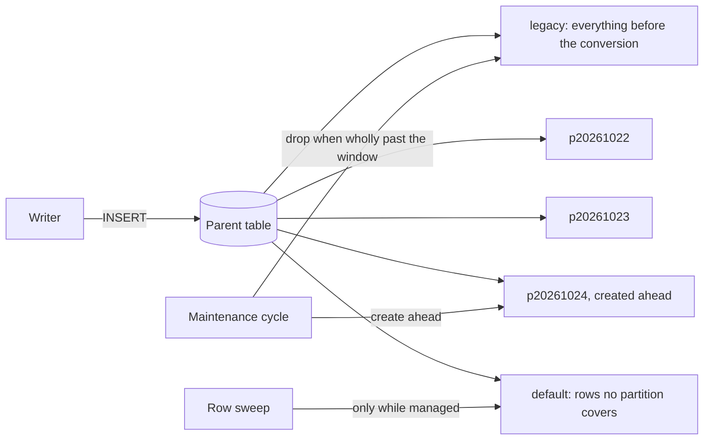

# Partitioned Ledgers

Retention on an append-only framework table used to be a batched `DELETE`. Every deleted row stays behind as a dead
tuple until vacuum reclaims it, the indexes keep pointing at it, and the delete itself writes WAL. A table that is
range-partitioned by time does retention differently: when a whole partition is past the window, the partition is
dropped. That is a catalog change, with no dead tuples, no index bloat and almost no WAL.

The built-in partition manager does this for the framework's own time-ordered tables. It is off by default.



## What is partitioned {#what-is-partitioned}

| Table | Partitioned by | Interval | Retention |
|---|---|---|---|
| `wh_log` | `logged_at`, primary key `(log_id, logged_at)` | weekly | `log_retention_days` (default 14), the window the row sweep used |
| `wh_signals` | `created_at`, primary key `(id, created_at)` | daily | `SignalRetention` (default 7 days), the durable-signal window ([signal bus](../../fundamentals/signal-bus/signal-bus#retention)) |
| `wh_lifecycle_completions` | `event_id` range, primary key `event_id` unchanged | daily | `LifecycleCompletionRetentionDays` (default 7); `0` keeps every partition |

Every partitioned table also has a **default partition** (`<table>_default`) that catches a row no partition covers,
so a writer never fails because maintenance has fallen behind. The default partition is never dropped.

The staging and trace tables of slim event metadata follow in a later release, created partitioned. The
deduplication ledger and `wh_perspective_applied` stay unpartitioned: the first is already bounded by its window, the
second is a sliding window over streams rather than a time-rolling log.

## Enabling it {#enabling-it}

{verified: PartitioningOptionsTests.Partitioning_BindsFromItsEnvironmentVariablesAsync, PartitioningOptionsTests.CreateAheadBelowOne_IsRejectedByNameAsync, PartitionMaintenanceStepTests.Disabled_ChangesNothingAsync}

| Key | Default | Environment variable | Meaning |
|---|---|---|---|
| `Whizbang:Workers:Maintenance:Partitioning:Enabled` | `false` | `Whizbang__Workers__Maintenance__Partitioning__Enabled` | Convert and maintain the partitioned tables |
| `Whizbang:Workers:Maintenance:Partitioning:CreateAhead` | `3` | `Whizbang__Workers__Maintenance__Partitioning__CreateAhead` | Intervals past the current one that each cycle makes sure exist; at least `1` |

```json{
title: "Turn on the partition manager"
description: "Enables partition maintenance and keeps four weeks of wh_log partitions ready ahead of the current one."
category: "Configuration"
difficulty: "INTERMEDIATE"
tags: ["partitioning", "maintenance", "wh_log", "appsettings"]
tests: ["PartitioningOptionsTests.Partitioning_BindsFromItsEnvironmentVariablesAsync"]
}
{
  "Whizbang": {
    "Workers": {
      "Maintenance": {
        "Partitioning": {
          "Enabled": true,
          "CreateAhead": 4
        }
      }
    }
  }
}
```

While it is off, nothing is converted, created or dropped, and every table keeps its row-by-row retention. A
`CreateAhead` below 1 is rejected at startup, naming the key.

The option is also published to `wh_settings` every cycle as `partition_maintenance_enabled`, in both directions
([database-side settings](../configuration/configuration-reference#database-side-settings)). The row sweep reads it:
it leaves a partitioned table to the partition drop while the option is on, and goes back to deleting rows when it is
switched off, so a converted table stays bounded either way.

## What a cycle does {#what-a-cycle-does}

{verified: PartitionMaintainSqlTests.ACycle_CreatesTheCurrentAndAheadPartitions_AndASecondCreatesNothingAsync, PartitionMaintainSqlTests.APartitionWhollyPastTheWindow_IsDropped_OneStraddlingItIsKeptAsync, PartitionMaintainSqlTests.TheDefaultPartition_IsNeverDroppedAsync, PartitionMaintainSqlTests.RowsInTheDefaultPartition_MoveIntoThePartitionCreatedForThemAsync, PartitionMaintainSqlTests.DebugMode_KeepsExpiredPartitionsAsync}

The partition maintenance step runs last in each [maintenance cycle](../../fundamentals/workers/maintenance-steps).
For each registered table it calls two SQL functions:

1. `wh_partition_convert(table, column, interval, now)` converts a plain table, once (see below). On a converted
   table it returns at once.
2. `wh_partition_maintain(table, interval, ahead, keep, now)`:
   - makes sure the default partition exists;
   - creates the partition for the current interval and `CreateAhead` more, skipping any range an existing partition
     already covers, so a second cycle creates nothing. Rows the default partition caught for a new range move into
     it;
   - drops every partition whose range ended at or before `now - keep`. A partition that straddles that moment is
     kept whole, so rows are kept at least as long as the window and at most one interval longer;
   - under `debug_mode`, keeps every partition, as the row sweeps keep every row.

It returns one row per change: `created`, `dropped`, `emptied`, `deferred`, `kept` or `skipped`, and the step logs
each one.

### Intervals and names {#intervals-and-names}

{verified: PartitionMaintainSqlTests.WeeklyPartitions_StartOnMondayAsync, PartitionMaintainSqlTests.HourlyPartitions_AreNamedByTheHourAsync, PartitionMaintainSqlTests.AnIntervalThatIsNotWholeHours_IsRejectedAsync}

An interval is a whole number of hours with no month part (a month is not a fixed length). Boundaries are counted in
UTC from Monday 2000-01-03, so a weekly partition starts on a Monday at 00:00 UTC and a daily one at midnight UTC.
Partitions are named `<table>_p<yyyymmdd>` after the day they start, or `<table>_p<yyyymmdd>_<hhmm>` for an interval
shorter than a day.

## Locks, and why no writer waits {#locks}

{verified: PartitionMaintainSqlTests.AnExpiredPartition_IsEmptiedWithoutBlockingAnInsertInFlightAsync, PartitionMaintainSqlTests.AnExpiredPartitionInUse_IsDeferredAsync, PartitionMaintainSqlTests.ANewPartition_IsDeferredWhileARowIsBeingWrittenToTheDefaultAsync}

A writer inserts through the parent table. It holds a `ROW EXCLUSIVE` lock on the parent and on the one partition its
row lands in, nothing more.

- **Creating a partition** builds it as a standalone table and attaches it, which takes `SHARE UPDATE EXCLUSIVE` on
  the parent. Inserts do not conflict with that. It also locks the default partition, which only a row outside every
  partition touches.
- **Dropping a partition** needs the parent's exclusive lock, because detaching changes the parent's list of
  partitions. The manager takes it only if it is free at that instant (`NOWAIT`), and then holds it for a catalog
  change of milliseconds.
- **When a writer is on the table,** that lock is not free, so the manager does not wait for it. It **empties** the
  expired partition instead (`TRUNCATE`), which locks that partition alone, and detaches the empty partition on a
  later cycle. The data is gone on schedule either way.
- **When a reader is on the expired partition itself,** or a writer is on the default partition while a new partition
  needs creating, that step is **deferred** to the next cycle.

No lock is ever waited for, so the manager never makes a writer queue behind it.

`DETACH PARTITION ... CONCURRENTLY` is not used. PostgreSQL refuses it while the table has a default partition, and
it cannot run inside a transaction block, which a function call always is.

## Only the maintainer runs it {#the-duty-gate}

{verified: DapperPartitionMaintenanceStepTests.AnInstanceNotHoldingTheMaintainerDuty_DoesNoDdlAsync, DapperPartitionMaintenanceStepTests.TheMaintainerDutyHolder_RunsTheCycleAsync, PartitionMaintainSqlTests.AnotherCycleInFlightOnTheTable_SkipsItAsync}

Partition DDL runs only on the instance that holds the **maintainer duty** where role assignment manages it
([capabilities and duties](../startup/capabilities-and-duties)); every other instance skips the step without error.
Where role assignment does not manage the maintainer duty, every instance runs the step, and a per-table advisory
lock inside the SQL lets one through while the others skip that table for the cycle. Two instances never change one
table's partitions at once.

Changing a table needs its owner's rights. The EF Core driver runs the step on the schema-initialization connection
(`ConnectionStrings:<name>-init`) when one is configured, as the startup migrations do
([database roles](migrations#database-roles)), and on the context's own connection otherwise.

### Time-ordered ids {#time-ordered-ids}

{verified: UuidPartitionSqlTests.AUuidBound_IsTheFirstIdOfItsMoment_AndReadsBackAsThatMomentAsync, UuidPartitionSqlTests.ACycle_CreatesDailyIdPartitions_AndAVersion7IdLandsInItsDayAsync, UuidPartitionSqlTests.APartitionWhollyPastTheWindow_IsDropped_OneStraddlingItIsKeptAsync, UuidPartitionSqlTests.AVersion4Id_LandsInTheDefaultPartitionAsync}

A table can also be partitioned by a `uuid` key, as `wh_lifecycle_completions` is by `event_id`. Framework ids are
UUIDv7: the first 48 bits are the moment the id was made, in Unix milliseconds, and PostgreSQL compares uuids byte by
byte. So the first id of a moment is that moment's milliseconds followed by zeros, and the ids made in one day are
exactly the range from that day's first id to the next day's. The manager reads the key's type from the catalog and
writes each boundary moment as the matching id, for example 2026-10-21 00:00 UTC as
`01a15bc1-f400-0000-0000-000000000000`. Intervals, names, the window and the locks are the same as for a timestamp
key.

An id that is not time-ordered (a version-4 id, whose first bits are random) is still accepted. No daily partition
covers it, so it lands in the default partition, which nothing drops; the row sweep keeps clearing that partition by
its own timestamp column ([row sweeps](#row-sweeps)).

## Converting an existing table {#converting-an-existing-table}

{verified: LogPartitionConversionTests.Conversion_KeepsEveryRow_InTheLegacyPartitionAsync, SignalPartitionConversionTests.Conversion_KeepsEverySignal_AndTheKeyGainsCreatedAtAsync, SignalPartitionConversionTests.ADurableSignal_IsStillPublishedAndDelivered_AfterConversionAsync, LifecycleCompletionPartitionConversionTests.Conversion_KeepsEveryCompletion_AndAVersion4IdMovesToTheDefaultPartitionAsync, EFCoreWorkCoordinatorLifecycleAndJanitorTests.LifecycleCompletions_AfterPartitioning_AreStillRecordedOnce_AndFoundByEventIdAsync, LogPartitionConversionTests.EveryWriter_StillInserts_IncludingASessionThatWroteBeforeTheConversionAsync, LogPartitionConversionTests.Conversion_InterruptedPartway_LeavesTheTableAsItWas_AndTheNextCycleCompletesItAsync, LogPartitionConversionTests.Conversion_WhileAWriterHoldsTheTable_IsDeferredAsync, LogPartitionConversionTests.TheMarker_StopsTheConversionRunningAgainAsync, LogPartitionConversionTests.Conversion_CarriesTheTablesGrantsToTheParentAsync}

The first enabled cycle converts each registered table that is still plain: `wh_log`, `wh_signals` and
`wh_lifecycle_completions`. Nothing is copied. For `wh_log`:

1. The table is renamed `wh_log_legacy`.
2. A partitioned parent named `wh_log` is created with the same columns, defaults, comments, grants and owner. Its
   primary key becomes `(log_id, logged_at)`, because PostgreSQL requires every unique key of a partitioned table to
   include the partition column, and it keeps drawing ids from the same sequence.
3. The default partition is added. A row whose key is at or past the start of the next interval (a time from a clock
   running ahead, or an id that is not time-ordered) moves into it, so one such row cannot fail the next step.
4. `wh_log_legacy` is attached as the oldest partition, covering everything before the start of the next week, and
   the parent's indexes are recreated under their original names, adopting the legacy table's indexes. The next
   cycle's partitions start where the legacy partition ends.

`wh_signals` converts the same way, daily: its primary key becomes `(id, created_at)`. Nothing references a signal
by its id alone; each instance's tail cursor compares ids (`id > cursor ORDER BY id`, and `MAX(id)` for a new
instance), which the parent's key, led by `id`, still answers in every partition. `wh_lifecycle_completions` is
partitioned by its key, `event_id`, so the key stays as it is and a second completion for one event is still
refused; its legacy partition covers every id below the first id of the next day.

Every function that writes these tables keeps working unchanged against the parent, including a session that wrote
before the conversion: a durable signal is still published and delivered, and a lifecycle completion is still
recorded once and found by its event id. The legacy partition is dropped like any other once its range is past the
window.

The conversion is **one transaction**. It takes the table's exclusive lock only if it is free (otherwise it returns
`deferred` and the next cycle tries again), and attaching checks every row against the range once, under that lock.
A failure anywhere rolls the whole conversion back, leaving the plain table as it was, and the next cycle starts
again. When it commits, it records the table's **conversion marker** (`wh_log_partition_version`,
`wh_signals_partition_version`, `wh_lifecycle_completions_partition_version`, each `= 1`) in `wh_settings`; with the
marker present the conversion never runs again
([conversion markers](migrations#conversion-markers)).

## Row sweeps {#row-sweeps}

{verified: LogPartitionConversionTests.OnceConverted_RetentionDropsPartitions_InsteadOfDeletingRowsAsync, SignalPartitionConversionTests.OnceManaged_TheSweepLeavesPartitionsToTheDrop_AndClearsOnlyTheDefaultAsync, SignalPartitionConversionTests.AConvertedTable_WithPartitioningSwitchedOff_IsStillSweptByRowAsync, EFCoreWorkCoordinatorLifecycleAndJanitorTests.CleanupLifecycleCompletionsAsync_OncePartitionedAndManaged_SweepsOnlyTheDefaultPartitionAsync, EFCoreWorkCoordinatorLifecycleAndJanitorTests.CleanupLifecycleCompletionsAsync_PartitionedWithMaintenanceSwitchedOff_SweepsByRowAsync, LifecycleCompletionPartitionConversionTests.TheSweepRelation_IsTheTable_UntilItIsPartitionedAndManaged_ThenItsDefaultPartitionAsync}

Each table keeps its row sweep, and the sweep decides each run what it may delete from:

| Table state | `wh_log` sweep | `wh_signals` sweep | `wh_lifecycle_completions` sweep |
|---|---|---|---|
| Plain, or partitioned with `Partitioning:Enabled` off | every row past the window | every row past the window that every instance has delivered | every row whose `completed_at` is past the window |
| Partitioned and maintained | skipped | the default partition only | the default partition only |

Once the manager keeps a table, its expired partitions are dropped whole, so a row delete there would only leave dead
tuples in the partition that straddles the window. The default partition is the exception: it holds rows no
partition covers (a version-4 event id, or a row written while maintenance had fallen behind), and no drop ever
reaches it, so the `wh_signals` and `wh_lifecycle_completions` sweeps keep clearing it with their usual predicate.
`wh_partition_sweep_relation(table)` answers which relation that is: the table, its default partition, or nothing.

Two differences from the row sweep follow from dropping by range:

- **Signals.** The signal sweep never deletes past the slowest instance's cursor. A partition drop is by age only, so
  a signal older than `SignalRetention` goes with its partition even if an instance has not delivered it. An
  instance that far behind is not tailing; keep `SignalRetention` longer than any outage you expect an instance to
  resume from.
- **Lifecycle completions.** The row sweep goes by `completed_at`; the partition drop goes by the time in the event
  id, which is never later. A completion is only looked up for events of the last 30 minutes, far inside the window,
  so dropping by the event's time loses nothing the reconcile reads.

## How a table registers {#how-a-table-registers}

{verified: PartitionedTableTests.TheLog_IsWeeklyByLoggedAt_KeptForItsRetentionSettingAsync, PartitionedTableTests.TheSignals_AreDailyByCreatedAt_KeptForTheDurableSignalWindowAsync, PartitionedTableTests.TheLifecycleCompletions_AreDailyByEventId_KeptForTheirRetentionDaysAsync, PartitionedTableTests.TheFrameworkTables_TakeTheirWindowsFromTheConfiguredOptionsAsync, DapperPartitionMaintenanceStepTests.AnIndefiniteWindow_DropsNothingAsync, PartitionedTableTests.AFixedWindow_IsCarriedAsIsAsync, DapperPartitionMaintenanceStepTests.AFixedWindow_DropsWhatEndedBeforeItAsync, DapperPartitionMaintenanceStepTests.TheLogsWindow_IsReadFromItsSettingAsync}

A framework table joins the manager by registering a declaration in the driver's service registration; the manager
itself does not change. The declaration names the table, its partition column (a `timestamptz`, or a time-ordered
`uuid`), the interval, and where the retention window comes from: a fixed span taken from an option at startup
(`SignalRetention`, `LifecycleCompletionRetentionDays`), a `wh_settings` key holding days with a default for when the
key has no row (read each cycle, so an operator's change applies to the next drop), or no window at all, which keeps
every partition. A plain table is
converted on its first enabled cycle; a table its migration creates partitioned is maintained as it is. The
declaration is internal to the framework.
